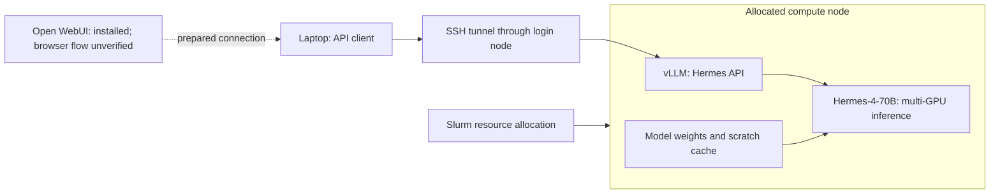

# Architecture & deployment walkthrough

[Project](../README.md) · [Evidence](evidence.md)

## Documented single-node workflow

This diagram summarises the architecture described in the records; it is not an application screenshot or live availability indicator. Open WebUI's dashed connection denotes preparation rather than a verified browser session.

## Walk through the work

1. **Allocate compute resources.** Request a compute node and GPU devices through Slurm. The login node is an access point, not the inference machine.
2. **Prepare the environment.** Set up Python dependencies and a node-local model/cache directory. Temporary scratch data may be removed between allocations.
3. **Load and serve Hermes.** The launch notes specify BF16 and TP8 × PP2 across 16 GPU devices within one node. They also describe memory and concurrency limits. Recorded settings vary across runs: one recipe uses an 8,192-token context, while the saved API response reports 16,384.
4. **Connect from the laptop.** Forward the service through SSH and query its model list with authentication. The recorded response contains model ID `hermes` and owner `vllm`.
5. **Prepare the chat interface.** The notes cover a Docker-based Open WebUI approach; later terminal output confirms a Python environment installation. The records do not establish a fully working browser conversation or a resolved tool-choice issue.
6. **Inspect and stop jobs.** Review queue state and inference logs, then release the allocation. Interactive sessions can be interrupted by loss of the laptop connection.

## Later two-node experiment

The later chat records show a pinned Qwen model revision downloaded successfully on both compute nodes. The subsequent vLLM startup failed during library import because `libcudart.so.13` was unavailable. This establishes preparation and a concrete compatibility issue, not a successful two-node service.

Suggested follow-up work is to align runtime dependencies on both nodes, make the long-running job independent of the laptop session, and record an end-to-end response plus a repeatable latency test. These are next steps, not completed results.

## What this demonstrates

Practical experience connecting resource scheduling, model deployment, multi-GPU configuration, remote access and client integration. The case also captures the difference between enough aggregate GPU memory and a deployment that starts reliably and responds quickly.
